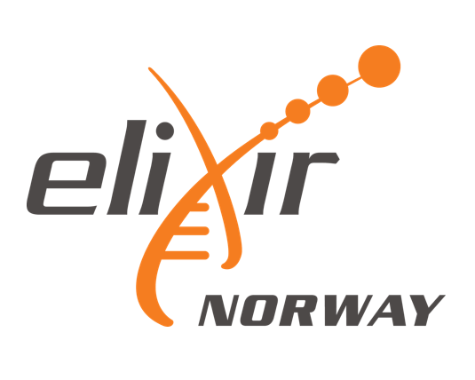

# 🧬 ELIXIR Norway, NeLS and Galaxy: Resources for RNA-seq Analysis

Introduction to ELIXIR Norway's bioinformatics resources,
NeLS data storage, and Galaxy for reproducible RNA-seq analysis.

## 📚 Course Information

- **Course:** PHVIT9560 – Bioinformatics
- **Institution:** OsloMet
- **Date:** 16 October 2026
- **Instructor:** Arturo Vera Ponce de Leon
- **Affiliation:** ELIXIR Norway / NMBU

## 🎯 Learning Objectives

By the end of this session, participants should be able to:

1. Identify bioinformatics services offered by ELIXIR Norway.
2. Understand the role of NeLS in research data management.
3. Navigate the Galaxy platform.
4. Understand the main steps of an RNA-seq analysis in Galaxy.
5. Find and reuse existing Galaxy training materials and workflows.

## 📂 Course Materials

### 📊 Lecture Slides

- 📕 [Lecture slides (PDF)](slides/ElixirAt_OsloMet_2026.pdf)
- 📑 [Lecture slides (PowerPoint)](slides/ElixirAt_OsloMet_2026.pptx)

### 🧪 Galaxy RNA-seq Tutorial

This session includes a demonstration of reference-based
RNA-seq analysis using Galaxy.

📖 **[RNA-seq Tutorial and Resources](docs/galaxy-rnaseq.md)**

## 🔗 Useful Resources

- 🧬 [ELIXIR Norway](https://elixir.no/)
- 💾 [NeLS – Norwegian e-Infrastructure for Life Sciences](https://nels.elixir.no/nels-web/#/)
- 🌌 [Galaxy Norway](https://usegalaxy.no/)
- 📚 [Galaxy Training Network](https://training.galaxyproject.org/)

## 📬 Contact

For questions, comments, or feedback about this course:

📧 **[auve@nmbu.no](mailto:auve@nmbu.no)**

For bioinformatics support or inquiries about ELIXIR Norway's services:

📧 **[support@elixir.no](mailto:support@elixir.no)**

---

**ELIXIR Norway | OsloMet | 2026**

  

